[](https://github.com/hacs/plugin)
[](https://github.com/jayjojayson/flexible-weather-card/actions?query=workflow%3Avalidate)
 
[](https://github.com/jayjojayson/flexible-weather-card/releases/)
[](https://www.paypal.me/quadFlyerFW)


---

# 🌤️ Flexible Weather Card

The **Flexible Weather Card** is a freely designable weather card for Home Assistant. Instead of a fixed layout, you get a **layout designer** in a popup window: drag the weather elements you want from a palette onto a grid, move them, resize them and adjust every element individually – no YAML required.

The card uses the weather integrations you already have in Home Assistant (e.g. DWD, Met.no, OpenWeatherMap, sun, moon, DWD weather warnings, Meteoalarm). If something is missing, it can load the data from the internet instead (Open-Meteo for weather, Bright Sky for DWD warnings) – or calculate it (sun and moon position).

German and English are included.

If you like the Card, I would appreciate a Star rating ⭐ from you. 🤗

**📖 Documentation:** [Elements](docs/elements.md) · [Color scales](docs/color-scales.md) · [Changelog](CHANGELOG.md) · [Installation](#installation) · [Layout designer](#the-layout-designer) · [Configuration](#configuration) · [Troubleshooting](#troubleshooting)

### ✨ New in v2.2
- **New element “3D earth”** – a globe like a weather satellite view: real satellite clouds, day and night with city lights, rain radar and your location. It turns slowly or looks at your home, can be turned with the mouse or a finger and zoomed up to 450 %. Optional **wind streams** layer: animated air currents with direction and speed from Open-Meteo (see [where the data comes from](#3d-earth--where-the-data-comes-from)).
- **New element “3D weather”** – an animated 3D diorama: a floating island with trees, lake, house and a wind turbine under a living sky, with all values as glass cards or freely in the graphic. Seasons, snow, frost, puddles, fog, lightning, rainbow and a warm sunrise / sunset light.
- **Sun position 3D** can show the 3D island on the ground of the dome, with a wind turbine or windsock and the weather values in the corners
- **Sunrise / sunset atmosphere** – warm sky and glow while the sun is close to the horizon, in *3D weather*, *Current weather* and *Temperature*
- **Weather scene** in *Current weather* **and now also in *Temperature*** (as background, layout unchanged)
- **Humidity and air pressure** also as column view with the course of the next hours
- **Narrow elements** (e.g. on a tablet): *Current weather* moves *feels like*, high / low and the details below the temperature instead of hiding them
- **Card grows proportionally** on wide screens (`design_width`, `keep_proportions`) and the *Dashboard page* template is shown in two columns on phones
- **Swipe** through further days / hours in the daily forecast, hourly forecast and trend chart
- **Temperature-colored curves**, animated low line, wind row and hourly chart
- **Thermometer** whose fill level and color follow the temperature
- **Image / iFrame presets** for Windy, WetterOnline, a radar loop and the DWD warning map
- **Own min / max sensors** are used in *Current weather*

Everything in detail: [CHANGELOG.md](CHANGELOG.md)

## Screenshots

<table>
  <tr>
    <td width="50%">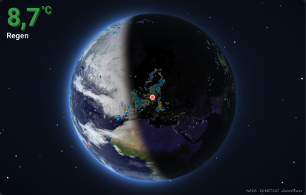<br><sub><b>3D earth</b> – real satellite clouds, day/night line and city lights</sub></td>
    <td width="50%">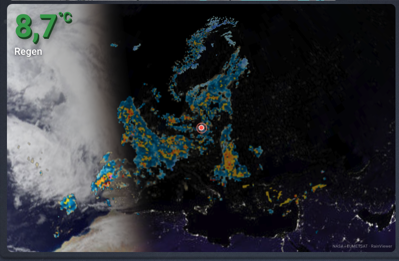<br><sub><b>3D earth, zoomed in</b> – rain radar over Europe at night, your location marked</sub></td>
  </tr>
  <tr>
    <td width="50%">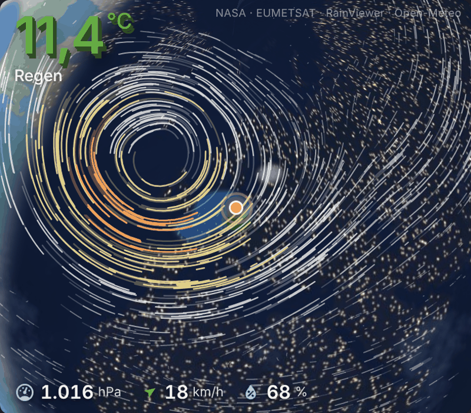<br><sub><b>3D earth with wind streams</b> – air currents with direction and speed (brighter / yellow / orange = stronger; example data)</sub></td>
    <td width="50%"></td>
  </tr>
  <tr>
    <td>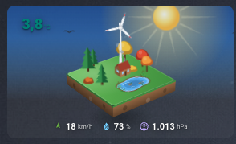<br><sub><b>3D weather</b> – sunny, sun rays turning slowly</sub></td>
    <td>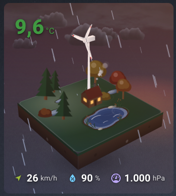<br><sub><b>3D weather</b> – rain at sunset, puddles, light in the house</sub></td>
  </tr>
  <tr>
    <td>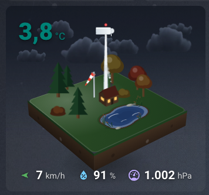<br><sub><b>3D weather</b> – evening with windsock, autumn trees</sub></td>
    <td>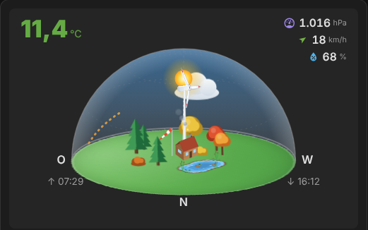<br><sub><b>Sun position 3D</b> – sun path in the dome with the 3D island and weather values</sub></td>
  </tr>
  <tr>
    <td>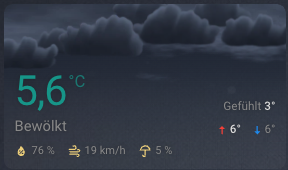<br><sub><b>Current weather</b> as animated weather scene</sub></td>
    <td>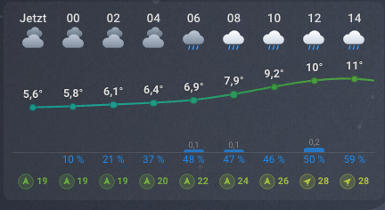<br><sub><b>Hourly forecast</b> with temperature curve, rain and wind</sub></td>
  </tr>
</table>

<table>
  <tr>
    <td width="36%">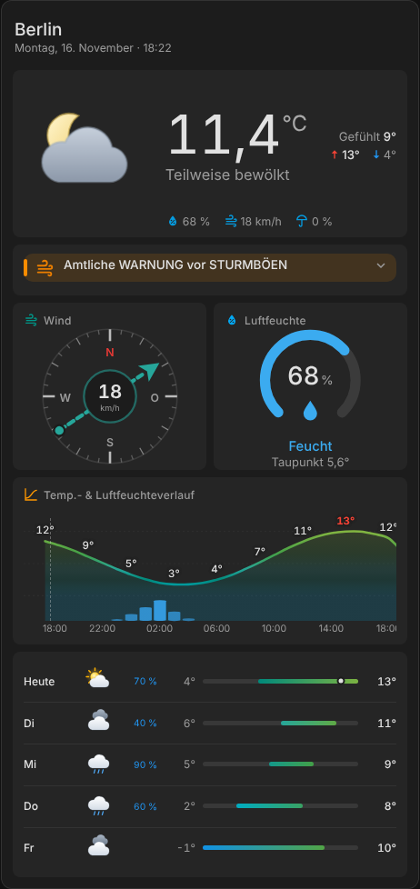<br><sub>Template <b>Standard</b></sub></td>
    <td width="36%">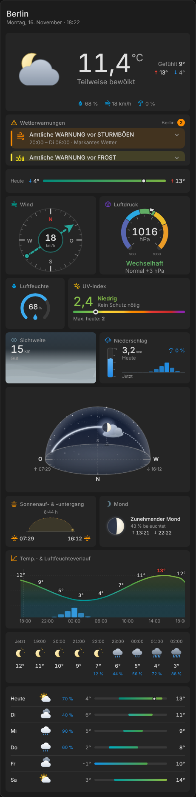<br><sub>Template <b>Detailed</b></sub></td>
    <td width="28%">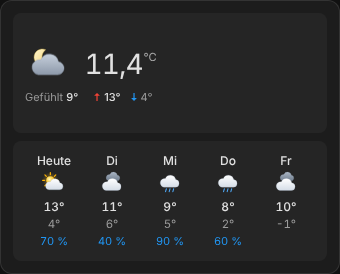<br><sub>Template <b>Compact</b></sub></td>
  </tr>
</table>

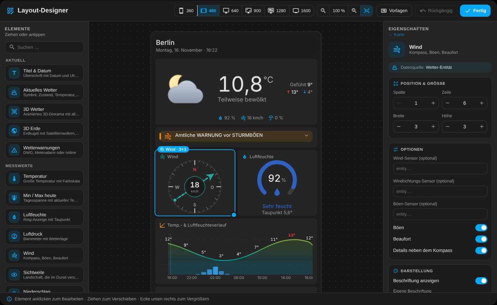
<sub><b>Layout designer</b> – drag elements from the palette onto the grid, resize them and change every option on the right, with live preview</sub>

## Features
- ### 🧩 **Layout designer** – popup window with drag & drop, resizing, live preview, undo, templates and keyboard shortcuts
- ### 🌡️ **27 weather elements** – temperature, min/max, humidity, pressure, wind compass, visibility, precipitation, UV, solar radiation, pollen, weather report, 3D sun dome, sunrise/sunset, moon, daily & hourly forecast, temperature & humidity trend, rain radar, 3D earth, warnings and more
- ### 🏠 **Uses your HA integrations** – weather entity, own sensors, `sun.sun`, moon sensor, DWD warnings, Meteoalarm
- ### 🌍 **Online fallback** – missing values are loaded from Open-Meteo (free, no API key); warnings from DWD via Bright Sky
- ### 🛰️ **Rain radar** – animated radar of the last hour (DWD in Germany, RainViewer worldwide)
- ### 📰 **Weather report** – DWD text report from your HA sensor or generated automatically from the forecast
- ### ☀️ **3D sun dome** – sun and moon path from the Sun Position Card, with animated weather effects
- ### 🎞️ **Animated weather icons** – sun, clouds, rain, snow, thunderstorm, fog, wind
- ### 🧊 **3D weather** – a diorama with clouds in several depths, rain, hail and snow falling into the scene, fog at the lake and a floating island with swaying trees and a wind turbine that turns with the real wind – the ground shows rain, drought, snow and frost
- ### 🌍 **3D earth** – a globe with real satellite clouds, day and night with city lights, rain radar and your location – slowly turning or fixed on your home
- ### 🌦️ **Real weather scene** – the current weather can be shown as an animated sky: realistic, self-shaded clouds (generated once, then only moved), sun with rays, moon in its real phase, stars, rain, snow, hail, lightning, fog and wind
- ### 📈 **Temperature-colored curves** – forecast and trend lines change color smoothly with the temperature; optional animated low line, wind row and hourly chart
- ### 👆 **Swipe** – daily forecast, hourly forecast and the trend chart scroll horizontally with the finger (or by dragging with the mouse) to show the following days / hours – no scrollbars, nothing to configure (`swipe: false` in YAML turns it off)
- ### 📐 **Free grid** – any number of columns, rows and gaps; elements adapt to their size automatically
- ### 🎨 **Follows your HA theme** – uses the Home Assistant theme variables (light & dark), sections view support
- ### 🔁 **Old configurations keep working** – v1 configs are converted to the new layout automatically

---

## Installation

### HACS (Recommended)

- Add this repository to HACS. To do so, use the following link.

 [](https://my.home-assistant.io/redirect/hacs_repository/?owner=jayjojayson&repository=flexible-weather-card&category=plugin)

- The "Flexible Weather Card" should now be available in HACS. Click "INSTALL".
- The resource will be added to your Lovelace configuration automatically.

<details>
  <summary> <b>Manual Installation via HACS</b></summary>  

1.  Open HACS in Home Assistant.
2.  Go to "Frontend" and click the three dots in the top right corner.
3.  Select "Custom repositories".
4.  Add the URL `https://github.com/jayjojayson/flexible-weather-card` and select "Lovelace" as the category.
5.  Click "ADD".
6.  The "Flexible Weather Card" should now be available in HACS. Click "INSTALL".
7.  The resource will be added to your Lovelace configuration automatically.
</details>

<details>
  <summary> <b>Manual Installation in HA</b></summary>  

### Manual Installation

1.  Download the `flexible-weather-card.js` from the [latest release](https://github.com/jayjojayson/flexible-weather-card/releases).
2.  Place the file in `config/www/community/flexible-weather-card/`.
3.  Add the resource to your Lovelace configuration through the Home Assistant UI:
    a. Go to "Settings" -> "Dashboards".
    b. Click on the three dots in the top right corner and select "Resources".
    c. Click on "+ ADD RESOURCE".
    d. Enter `/local/community/flexible-weather-card/flexible-weather-card.js` as the URL and select "JavaScript Module" as the Resource type.
    e. Click "CREATE".
4.  Restart Home Assistant.
</details>

---

## The layout designer

Add the card to a dashboard and open the card editor. At the top you will find the button **“Open layout designer”**.

1. **Pick a template** (Compact, Standard, Detailed, Sun & moon, 3D weather detailed, Dashboard page) or start with an empty grid. *Dashboard page* is a complete page for the full width of a dashboard (12 columns, designed at 1280 px) with weather map, warning map, 3D island, forecast, weather report, chart and rain radar – on phones it is shown in two columns automatically.
2. **Drag elements** from the palette on the left onto the grid – or tap them to append them at the bottom.
3. **Move** elements by dragging them. If you drop an element on another element of the same size, the two swap places; otherwise the elements below move down.
4. **Resize** with the handle in the bottom-right corner of the selected element.
5. **Edit properties** on the right: position & size, data source, element options, label, style and accent color.
6. Without a selection, the right pane shows the **card settings**: columns, row height, gap, padding, tile style, background, font size, animations and the list of all elements.

The preview width can be switched between 360 / 480 / 640 / 900 / 1280 / 1600 px to check how the card looks on a phone or on a large screen. The card remembers the chosen width (`design_width`) and the designer opens with it next time. Large previews can be **zoomed** in the header (− / + / *Fit*) or with **Ctrl + mouse wheel** (Ctrl + / − / 0), so you see the whole card without scrolling.

> **Full width on large screens:** design the card at the width you use (e.g. 1280 for a full-width dashboard) – or at a smaller width: with `keep_proportions` (default) the card then grows proportionally on wider screens and keeps the look from the designer. For more elements side by side you can use up to 24 columns.

| Shortcut | Action |
| --- | --- |
| `←` `→` `↑` `↓` | Move the selected element by one cell |
| `Shift` + arrows | Resize the selected element |
| `Ctrl` + `D` | Duplicate |
| `Del` / `Backspace` | Delete |
| `Ctrl` + `Z` | Undo |
| `Esc` | Deselect / close the designer |

---

## Data sources

The card collects every value from the first source that has it:

1. **Own sensor** of the element (e.g. a temperature sensor on the balcony)
2. **Own sensors** of the card (`sensors:` – override the weather entity for the whole card)
3. **Own sensor of another element** – if no card sensor is set, a sensor you gave one element (e.g. your humidity sensor in the *Humidity* element) is used by all other elements of the card too, so *3D weather*, *Current weather* and the humidity tile always show the same value
4. **Weather entity** (`weather_entity`) – current values and the forecast (via `weather/subscribe_forecast`)
5. **Open-Meteo** (online, if `online_fallback` is not `false`) – only for values that are still missing, e.g. visibility or the hourly forecast if your weather entity doesn't provide them. Without a weather entity, all weather data comes from Open-Meteo.

| Data | Source |
| --- | --- |
| Sun position, sunrise / sunset | `sun.sun` (or `sun_entity`), otherwise calculated from your HA location |
| Moon phase, illumination, moonrise / moonset | `sensor.moon_phase` (or `moon_entity`) for the phase, the rest is calculated |
| Weather warnings | `warning_entities`, otherwise DWD Weather Warnings sensors are detected automatically; Meteoalarm binary sensors are supported. Without an entity: DWD warnings online via Bright Sky (Germany only) |
| Solar radiation | `sensors.solar_radiation` or element sensor, otherwise Open-Meteo (current value, day curve, day total) |
| Low / high today | `sensors.temperature_min` / `sensors.temperature_max`, otherwise the entities of a `minmax` element, otherwise the forecast – used by *Current weather* and *Min / max today* |
| Pollen | Your pollen sensors (e.g. DWD Pollenflug, index 0–3) or online via the Open-Meteo air quality API (CAMS, Europe only) |
| Weather report | A text sensor (e.g. the DWD weather report sensor, attribute `data`), otherwise generated from the forecast |
| 3D earth | Always online: satellite pictures from [Live Cloud Maps](https://github.com/matteason/live-cloud-maps), rain radar from RainViewer and optional wind streams from Open-Meteo – details in the next section |
| Rain radar | DWD radar (GeoServer, Germany) or RainViewer (worldwide, max. zoom 7, last 2 hours). Base map: Esri Canvas light/dark (no key, place names as separate layer above the radar), alternatively OpenStreetMap or CARTO with your own free API key (`map_key`, [request here](https://carto.com/basemaps/apikey/)) |

Entities you set in the card editor (own sensors, sun, moon, warnings) are shown in the designer as the element's entity with the hint *“From the card settings”*, as long as the element has no entity of its own.

When online data is used, the card shows the source at the bottom (can be switched off with `show_attribution: false`). Online data is cached for 15 minutes (warnings: 10 minutes) and shared by all cards.

### 3D earth – where the data comes from

The *3D earth* element is the only element that **always** needs the internet: the globe is made of pictures that are downloaded by your browser. Everything else (turning, day/night line, marker) is calculated in your browser.

| What you see | Where it comes from | How fresh |
| --- | --- | --- |
| Earth by day with clouds | `earth.jpg` from [Live Cloud Maps](https://github.com/matteason/live-cloud-maps): cloud picture from weather satellites (data: **EUMETSAT**) placed on NASA's *Blue Marble* picture of the earth | new picture every 3 hours (8 times a day) |
| Earth at night with city lights | `earth-night.jpg` from Live Cloud Maps: the same clouds on NASA's *Earth at Night* picture | every 3 hours |
| Rain and snow | [RainViewer](https://www.rainviewer.com/) – composite of the national weather radars, newest picture. The card asks every 5 minutes which picture is the newest and then loads it as a world map of small tiles (16 tiles, from 250 % zoom 64 tiles in a finer resolution) | RainViewer renews the radar every 5 minutes |
| Day/night line | calculated from date and time (position of the sun) | always current |
| Wind streams (optional, `show_wind`) | [Open-Meteo](https://open-meteo.com/) forecast API – wind speed and direction 10 m above the ground on a grid of **423 points** (306 points every 10° × 20° around the whole earth plus 117 points every 4° × 5° around your region). Between the points and between the hours the card interpolates; the moving lines are calculated in your browser | the forecast models are updated several times a day; the card loads the grid **at most every 6 hours** (12 hours ahead) and follows the wind hour by hour |
| Your location (marker, view) | the location of your Home Assistant instance or `location:` of the card | – |

**Addresses the browser loads from:**
- `https://clouds.matteason.co.uk/images/<size>/earth.jpg` and `…/earth-night.jpg` – `<size>` is 1024x512, 2048x1024 or 4096x2048. The card takes the smallest picture that is sharp enough for the shown size of the globe (`quality`: `low` max. 1024, `normal` max. 2048 – from 200 % zoom 4096 –, `high` max. 4096).
- `https://api.rainviewer.com/public/weather-maps.json` (list of the newest radar pictures) and `https://tilecache.rainviewer.com/…` (the radar tiles).
- Only with `show_wind: true`: `https://api.open-meteo.com/v1/forecast?latitude=…&longitude=…&hourly=wind_speed_10m,wind_direction_10m…` – 3 requests with up to 150 grid points each.

**What is sent – privacy:** the satellite pictures and radar tiles are the same for every user – for them the card does **not send your location** or any other data about you; your location is only used inside your browser to turn the globe and to place the marker. **Exception wind streams:** the finer regional grid is placed around your location (rounded to 2°, i.e. a box of about 32° × 60°, in Central Europe roughly 3,500 × 4,000 km), so Open-Meteo can see the rough region you are in from the coordinates of the request – but never your exact location. The global grid is the same for everybody. The servers only see what every web request shows (IP address, browser). Pictures are only loaded while the element is shown and are kept in the browser cache; the satellite pictures are loaded again at most every 3 hours.

**Licenses and credits:** Live Cloud Maps releases its pictures into the public domain (CC0 1.0). The cloud data comes from EUMETSAT, which asks for the note *“Contains modified EUMETSAT data”*. The NASA pictures of the earth are in the public domain (works of the US government). RainViewer's free API may be used for personal and educational use with a visible credit. The wind data from Open-Meteo is licensed under CC BY 4.0; the free API is for non-commercial use. The globe therefore always shows *NASA · EUMETSAT · RainViewer* (and *· Open-Meteo* with wind streams) in the corner.

**Good to know**
- The clouds are **observed**, not the forecast – what the globe shows is what the satellites saw, up to 3 hours ago. The rain is the measured radar of the last minutes.
- Satellites don't see the polar regions; Live Cloud Maps fills them with a mirrored strip. Now and then a satellite misses an area, which shows up as a small gap.
- Rain radar only exists where countries run weather radars (mainly Europe, North America, parts of Asia and Australia) – over the oceans no rain is shown.
- Live Cloud Maps is a free private project without guarantee. If it can't be reached, the globe shows *“Satellite image not reachable”*. You can host the pictures yourself (e.g. downloaded every 3 hours by an automation into your `www` folder) and use them with `day_image` / `night_image`.
- Wind streams are a **forecast** (weather models, current hour), not a measurement – unlike clouds and rain. Speed is shown by brightness and color: faint white = light wind, brighter white = stronger, yellow from 15 m/s (54 km/h, gale), orange from 22 m/s (79 km/h, storm).
- **Open-Meteo limits for the free API:** 10,000 calls per day, 5,000 per hour, 600 per minute. A request with many points is counted like many calls – one wind update (423 points) therefore counts as roughly 423 calls. The card keeps the data in the browser (`localStorage`) and loads it again only after 6 hours, so one device needs at most about 1,700 per day; all globes of one dashboard share the same data. After an error (e.g. *429 – too many requests*) the card waits 3 hours (other errors 30 minutes) and keeps this pause also after reloading the page. The layer is **off by default** – if many devices in your home show it, or other integrations also use Open-Meteo from the same internet connection, the shared limit can be reached.
- Ad blockers, Pi-hole or a firewall must allow `clouds.matteason.co.uk`, `api.rainviewer.com` and `tilecache.rainviewer.com` (with wind streams also `api.open-meteo.com`).
- The globe is drawn with WebGL on the graphics chip. It only animates while it turns and is visible; without WebGL a simple globe is shown.

---

## Elements

The card consists of **27 elements**. Each element is explained in detail – with all options, defaults and examples – in the **[element reference](docs/elements.md)**. Overview:

| Group | Type | Element | What it shows |
| --- | --- | --- | --- |
| Current | [`header`](docs/elements.md#header--title--date) | Title & date | Heading with date, time and optional weather icon |
| Current | [`current`](docs/elements.md#current--current-weather) | Current weather | Temperature, condition, feels like, low / high, details – optionally as animated **weather scene** |
| Current | [`weather3d`](docs/elements.md#weather3d--3d-weather) | 3D weather | Animated 3D diorama (island, clouds, rain, snow, …) with all values on glass cards |
| Current | [`earth`](docs/elements.md#earth--3d-earth) | 3D earth | Globe with real satellite clouds, day/night line with city lights, rain radar and your location – turning or fixed |
| Current | [`warnings`](docs/elements.md#warnings--weather-warnings) | Weather warnings | Active warnings (DWD, Meteoalarm) |
| Measurements | [`temperature`](docs/elements.md#temperature) | Temperature | Value with **thermometer**, optionally on the animated **weather scene** |
| Measurements | [`minmax`](docs/elements.md#minmax--min--max-today) | Min / max today | Low and high of the day with times |
| Measurements | [`humidity`](docs/elements.md#humidity) | Humidity | Ring gauge, rating, dew point |
| Measurements | [`pressure`](docs/elements.md#pressure--air-pressure) | Air pressure | Gauge with colored zones |
| Measurements | [`wind`](docs/elements.md#wind--wind-compass) | Wind compass | Direction, speed, gusts, Beaufort |
| Measurements | [`visibility`](docs/elements.md#visibility) | Visibility | Landscape that fades into haze |
| Measurements | [`precipitation`](docs/elements.md#precipitation) | Precipitation | Rain gauge, probability, hourly bars |
| Measurements | [`uv`](docs/elements.md#uv--uv-index) | UV index | Value, scale, protection hint |
| Measurements | [`solar`](docs/elements.md#solar--solar-radiation) | Solar radiation | W/m², curve of the day, day total |
| Measurements | [`pollen`](docs/elements.md#pollen) | Pollen | Load per plant |
| Measurements | [`report`](docs/elements.md#report--weather-report) | Weather report | Text report (DWD or generated) |
| Measurements | [`value`](docs/elements.md#value--single-value) | Single value | One number with icon |
| Sun & moon | [`sun`](docs/elements.md#sun--sun-position-3d) | Sun position 3D | Sky dome with sun / moon path and weather effects |
| Sun & moon | [`sun_times`](docs/elements.md#sun_times--sunrise--sunset) | Sunrise & sunset | Sun arc, day length, remaining daylight |
| Sun & moon | [`moon`](docs/elements.md#moon) | Moon | Phase, illumination, moonrise / moonset |
| Forecast | [`forecast_daily`](docs/elements.md#forecast_daily--daily-forecast) | Daily forecast | List or columns with curves, rain, wind – **swipe** up to 16 days |
| Forecast | [`forecast_hourly`](docs/elements.md#forecast_hourly--hourly-forecast) | Hourly forecast | Hours as row or chart – **swipe** up to 48 h |
| Forecast | [`chart`](docs/elements.md#chart--temperature--humidity-trend) | Temperature & humidity trend | Line chart with rain bars – **swipe** |
| Forecast | [`radar`](docs/elements.md#radar--rain-radar) | Rain radar | Animated radar loop on a map |
| Other | [`sensor`](docs/elements.md#sensor--any-entity) | Any entity | Tile for any HA entity |
| Other | [`image`](docs/elements.md#image--image--iframe) | Image / iFrame | Picture or web page, with presets (Windy, WetterOnline, …) |
| Other | [`card`](docs/elements.md#card--any-lovelace-card) | Any Lovelace card | Embeds another card |

Options that every element understands: `id`, `type`, `x`, `y`, `w`, `h` (grid position in cells), `show_title`, `title`, `style` (`tile` / `outline` / `flat` / `accent` / `none`), `color` (accent color), `radius` (corner radius in px) and `tap_action` (any Home Assistant action).

### Swipe

*Daily forecast*, *Hourly forecast* and *Temperature & humidity trend* load more data than they show (16 days / 48 hours). Swipe sideways with the finger – or drag with the mouse – to see the following days or hours. There is nothing to switch on and there are no scrollbars. The option `days` / `hours` / `range` decides how much is visible at once. If you don't want swiping, set `swipe: false` on the element in YAML.

---

## Configuration

The card is fully configurable via the visual editor and the layout designer. You can also configure it in YAML:

### Card options

| Name | Type | Default | Description |
| --- | --- | --- | --- |
| `type` | `string` | | `custom:flexible-weather-card` |
| `weather_entity` | `string` | | Weather entity, e.g. `weather.home` |
| `online_fallback` | `boolean` | `true` | Load missing values from Open-Meteo |
| `sensors` | `map` | | Own sensors for `temperature`, `temperature_min`, `temperature_max`, `apparent_temperature`, `dew_point`, `humidity`, `pressure`, `wind_speed`, `wind_gust`, `wind_bearing`, `visibility`, `uv_index`, `cloud_coverage`, `precipitation`, `precipitation_probability`, `solar_radiation` |
| `sun_entity` | `string` | `sun.sun` | Sun entity |
| `moon_entity` | `string` | `sensor.moon_phase` | Moon phase sensor |
| `warning_entities` | `list` | automatic | Warning sensors (DWD Weather Warnings, Meteoalarm) |
| `warnings_online` | `boolean` | `true` | DWD warnings via Bright Sky if there is no warning entity |
| `location` | `map` | HA location | `latitude` / `longitude` for online data and calculations |
| `language` | `string` | HA language | `de` or `en` |
| `columns` | `number` | `6` | Number of grid columns (1 – 24) |
| `row_height` | `number` | `56` | Height of a grid row in px (like the HA sections grid) |
| `gap` | `number` | `8` | Gap between elements in px |
| `padding` | `number` | `12` | Inner padding of the card in px |
| `tile_style` | `string` | `tile` | Default style of all elements: `tile`, `outline`, `flat` |
| `card_style` | `string` | | `transparent` removes the card background (e.g. inside other cards) |
| `font_scale` | `number` | `1` | Scales all fonts (0.8 – 1.3) |
| `element_radius` | `number` | theme | Corner radius of all elements in px (an element's own `radius` wins) |
| `animations` | `boolean` | `true` | Animated icons and effects |
| `respect_reduced_motion` | `boolean` | `true` | Turn animations off automatically if the device has *reduce motion* enabled |
| `mobile_layout` | `boolean` | `true` | Cards with more than 6 columns (e.g. a full dashboard page) are rearranged into **at most two columns** on phones: wide elements use the full width, small ones stand in pairs, in the order of the grid. `false` = keep the grid |
| `mobile_breakpoint` | `number` | `600` | Card width in px below which the phone layout is used |
| `design_width` | `number` | | Preview width chosen in the designer (360 – 1600 px). Saved automatically; the designer opens with it again |
| `keep_proportions` | `boolean` | `true` | If the card is wider than `design_width` (e.g. *Full width* on a large screen), it grows proportionally – rows, gaps and text scale with it – so it looks like in the designer instead of being stretched. `false` = stretch only the width (old behaviour) |
| `show_attribution` | `boolean` | `true` | Show the online data source at the bottom of the card |
| `elements` | `list` | | The elements of the layout (see above) |

### Simple example

```yaml
type: custom:flexible-weather-card
weather_entity: weather.home
elements:
  - type: header
    x: 0
    y: 0
    w: 6
    h: 1
  - type: current
    x: 0
    y: 1
    w: 6
    h: 3
  - type: forecast_daily
    x: 0
    y: 4
    w: 6
    h: 4
```

### Advanced example

```yaml
type: custom:flexible-weather-card
weather_entity: weather.dwd_berlin
sensors:
  temperature: sensor.balcony_temperature
  humidity: sensor.balcony_humidity
warning_entities:
  - sensor.berlin_current_warning_level
columns: 6
elements:
  - type: current
    x: 0
    y: 0
    w: 6
    h: 3
  - type: warnings
    x: 0
    y: 3
    w: 6
    h: 2
    hide_when_empty: true
  - type: wind
    x: 0
    y: 5
    w: 3
    h: 3
  - type: pressure
    x: 3
    y: 5
    w: 3
    h: 3
  - type: sun
    x: 0
    y: 8
    w: 6
    h: 4
  - type: chart
    x: 0
    y: 12
    w: 6
    h: 3
    range: "24"
  - type: image
    x: 0
    y: 15
    w: 6
    h: 4
    url: https://www.dwd.de/DWD/wetter/radar/radfilm_ber_akt.gif
    refresh: 300
```

### Image presets
The *Image / iFrame* element has presets for Windy, WetterOnline, the radar loop of wetterdienst.de and the DWD warning map – see the [element reference](docs/elements.md#image--image--iframe).

```yaml
  - type: image
    preset: windy
    overlay: rain
    zoom: 6
```

### Upgrading from v1

Old configurations (`weather_source`, `temp_entity`, `entities`, `iframes`, `cards`, …) are converted to elements automatically when the card loads. As soon as you save the card in the editor, the new format is written.

---

## Troubleshooting

| Problem | Solution |
| --- | --- |
| The card says there is no data | Select a `weather_entity` in the card editor – or leave it empty and the data is loaded online from Open-Meteo (needs the location of your HA instance or `location:`). |
| My own min / max sensor can't be selected | In the card editor (*Low today* / *High today*) and in the *Min / max today* element all `sensor` and `input_number` entities are offered. Reload the page (`Ctrl` + `F5`) after updating the card. |
| *Current weather* shows other low / high values than my sensor | Set the sensors in the card editor (`sensors.temperature_min` / `temperature_max`) or as `min_entity` / `max_entity` of a *Min / max today* element. |
| An iFrame stays empty | Some websites forbid being embedded. Use a preset or the picture URL of the page (`mode: image`). |
| The rain radar shows no map | Use the default Esri map. For CARTO you need your own free API key in `map_key`. |
| No swiping | The element shows all days / hours already. Increase the size of the element or reduce `days` / `hours` so that there is more data than visible. Swiping can be switched off with `swipe: false`. |
| The card does not update after an update | Clear the browser cache (`Ctrl` + `F5`), in the HA companion app reset the frontend cache in its settings. |
| Missing values (visibility, pollen, …) | Many integrations don't provide them. The card loads them from Open-Meteo – the source is shown at the bottom (`show_attribution`). |
| *3D earth* shows *“Satellite image not reachable”* | The browser can't load the pictures. Check ad blocker / Pi-hole / firewall for `clouds.matteason.co.uk`, or use your own pictures (`day_image` / `night_image`), see [3D earth – where the data comes from](#3d-earth--where-the-data-comes-from). |
| *3D earth* shows no rain | Rain radar only exists over land with weather radars, and `api.rainviewer.com` / `tilecache.rainviewer.com` must be reachable. |
| *3D earth* shows no wind streams | `show_wind` must be on and `api.open-meteo.com` reachable. After *too many requests* (429) the card pauses for 3 hours. |
| *3D earth* can't be turned | Turning is off in the layout designer (so you can move the element) and with `interactive: false`. With a finger the globe turns left / right, so the dashboard can still be scrolled up and down. |

---

## Styling

The card uses the Home Assistant theme variables (`--ha-card-background`, `--ha-card-border-radius`, `--primary-text-color`, `--secondary-text-color`, `--divider-color`, `--primary-color`, `--rgb-primary-text-color` and the HA color variables like `--blue-color`, `--teal-color`, `--orange-color`). Additional variables of the card:

| Variable | Description |
| --- | --- |
| `--fwc-tile-background` | Background of the element tiles |

### CSS elements you can target with card-mod

| Selector | Description |
| --- | --- |
| `ha-card` | The entire card |
| `.fwc-grid` | The layout grid |
| `.fwc-el` | Every element (tile) |
| `.fwc-el.t-<type>` | Element of one type, e.g. `.fwc-el.t-wind` |
| `.fwc-head` | Label row of an element |
| `.cur-temp` | Large temperature of the current weather |
| `.fwc-attrib` | Data source line at the bottom |

```yaml
type: custom:flexible-weather-card
weather_entity: weather.home
card_mod:
  style: |
    .fwc-el.t-current {
      background: linear-gradient(135deg, rgba(3,169,244,.25), transparent);
    }
    .cur-temp {
      color: dodgerblue;
    }
```

---

## Development

The sources are in `src/`, `build.js` bundles them into `dist/flexible-weather-card.js` (this happens automatically by the GitHub workflow on every push to `src/`):

| File | Content |
| --- | --- |
| `src/fwc-core.js` | Translations, formatting, units, astronomy, online data, data model, grid logic |
| `src/fwc-earth.js` | The 3D earth (WebGL globe, satellite pictures, radar mosaic, turning) |
| `src/fwc-elements.js` | Animated icons, 3D dome and all elements with their styles |
| `src/flexible-weather-card.js` | The card |
| `src/flexible-weather-card-editor.js` | The card editor |
| `src/flexible-weather-card-designer.js` | The layout designer (popup) |

```bash
node build.js
```

Documentation lives in `docs/` ([element reference](docs/elements.md), [color scales](docs/color-scales.md)) and `CHANGELOG.md`. When you add or change an element option, please update `docs/elements.md` and the changelog as well.

## Credits

- Weather, solar and pollen data: [Open-Meteo](https://open-meteo.com/) (CC BY 4.0, pollen: CAMS) · DWD warnings via [Bright Sky](https://brightsky.dev/)
- Rain radar: [DWD GeoServer](https://maps.dwd.de/) · [RainViewer](https://www.rainviewer.com/) · map tiles © Esri, HERE, Garmin, © [OpenStreetMap](https://www.openstreetmap.org/copyright) contributors (optional © CARTO)
- 3D earth: satellite pictures from [Live Cloud Maps](https://github.com/matteason/live-cloud-maps) by Matt Eason (CC0) – contains modified EUMETSAT data; earth pictures NASA *Blue Marble* and *Earth at Night*; precipitation by [RainViewer](https://www.rainviewer.com/); wind streams by [Open-Meteo](https://open-meteo.com/) (CC BY 4.0)
- 3D sun dome and weather effects from my Sun Position Card
